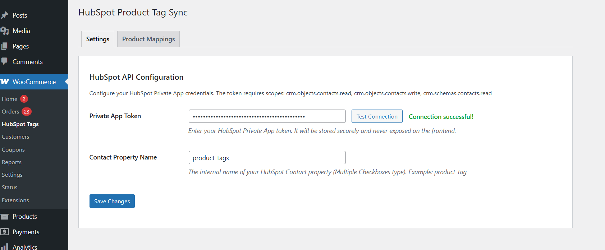
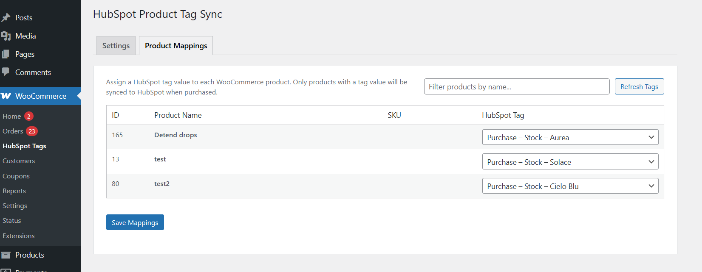

# Product Tag Sync for HubSpot (WooCommerce → HubSpot)

**Product Tag Sync for HubSpot** is a free WordPress plugin that **tags HubSpot contacts by the WooCommerce products they buy**. Map each WooCommerce product to a HubSpot tag value; when a customer places an order, the plugin creates or updates their HubSpot contact and appends the mapped tags to a custom contact property, without overwriting existing tags. That lets you segment HubSpot contacts by what they purchased.

**[Download free on WordPress.org →](https://wordpress.org/plugins/product-tag-sync-for-hubspot/)** · A [Nowdigiverse](https://nowdigiverse.com) product

## How it works

1. Map your WooCommerce products to HubSpot tag values in the admin panel.
2. When a customer places an order, the plugin creates or updates their HubSpot contact.
3. The mapped tags are appended to the contact's custom property (without overwriting existing tags).

## Features

- Automatic contact sync on order processing
- Admin UI for product → tag mapping (no code changes needed)
- Appends tags without overwriting existing values
- Prevents duplicate tag assignments
- One-click HubSpot connection test
- Product search filter for easy mapping management
- Secure token storage (never exposed on the frontend)
- Silent failure: never breaks the checkout flow
- Detailed logging for debugging (via the WordPress debug log)

## HubSpot setup requirements

- A HubSpot **Private App** with scopes: `crm.objects.contacts.read`, `crm.objects.contacts.write`, `crm.schemas.contacts.read`
- A custom **Contact property** (Multiple Checkboxes type) with defined option values

## Installation

1. Upload the plugin files to `/wp-content/plugins/product-tag-sync-for-hubspot/`, or install through the WordPress Plugins screen.
2. Activate the plugin on the **Plugins** screen.
3. Go to **WooCommerce → HubSpot Tags** to configure.
4. Enter your HubSpot Private App token and test the connection.
5. Set your HubSpot Contact Property Name (for example `product_tag`).
6. Open the **Product Mappings** tab and assign tag values to your products.

**Requirements:** WordPress 6.0+, PHP 7.4+, WooCommerce.

## Screenshots

| Settings | Product mappings |
|---|---|
|  |  |
| Configure your HubSpot Private App token and Contact Property. | Map WooCommerce products to specific HubSpot tags. |

## FAQ

**What HubSpot property type should I use?**
A "Multiple Checkboxes" field on the Contact object. It stores multiple semicolon-separated values.

**Will this overwrite existing contact tags?**
No. The plugin fetches existing tag values, merges them with the new ones, removes duplicates and saves the combined result.

**What happens if the HubSpot API is down?**
The plugin fails silently and logs the error. Your customers' checkout is never affected.

**Can I map multiple products to the same tag?**
Yes. If a customer buys several products that share a tag, the tag appears only once.

## How it compares

| | Product Tag Sync for HubSpot | HubSpot for WooCommerce (MakeWebBetter) |
|---|---|---|
| Scope | One narrow job: tag HubSpot contacts by the WooCommerce products they bought | Full integration: contact, deal and order sync |
| Price | Free | See the plugin's listing |
| Setup | HubSpot Private App token + one custom contact property | See the plugin's docs |

Product names are trademarks of their owners; listed for comparison only.

## Changelog

### 1.0.0
- Initial release.
- Contact sync on order processing.
- Admin settings with HubSpot token and property configuration.
- Product-to-tag mapping UI.
- Tag append logic with deduplication.
- Connection test button.
- Product filter in mapping table.

## License

[GPLv2 or later](LICENSE). © Nowdigiverse.
